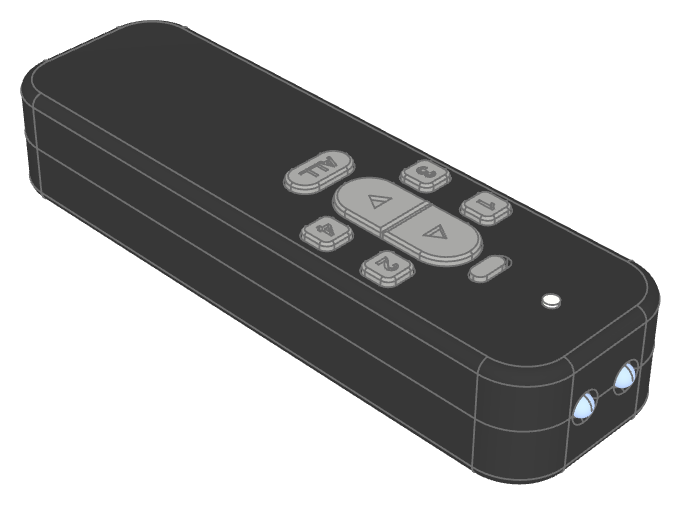
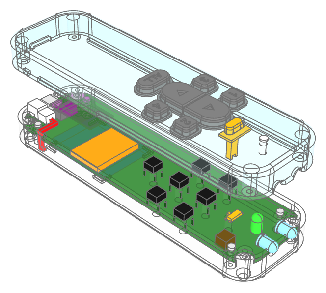
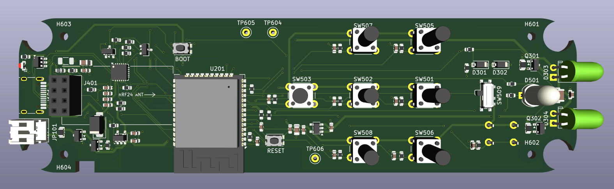

# HD Platinum Remote Clone

|  |  |
|:---:|:---:|
| Assembled (CAD render) | Exploded (CAD render) |



*The board inside, rev 1 (KiCad render). More in [hardware/](hardware/README.md).*

A DIY replacement for the handheld remote used with Hunter Douglas **Platinum Technology** motorized shades (the 2013-era system, before PowerView). It's built on an ESP32 with an IR LED (plus an IR receiver on the breadboard version, for capturing the original remote) and an nRF24L01+ 2.4 GHz radio.

> Personal hobby project. Not affiliated with or endorsed by Hunter Douglas. "Hunter Douglas", "Platinum" and "PowerView" are their trademarks and are used here only to say what this works with.

## Goal

Replace a degraded original remote with a homemade one that can:

- **Point and press (IR, 40 kHz):** control a single shade by aiming at its sensor eye. This is the arrows' default mode (red LED).
- **Group control (RF, 2.4 GHz):** pressing a group key (1–4 or ALL) opens a short window in which the arrows control that group over RF (green LED), as on the original.
- Run on batteries, sleeping deeply between presses and waking on a button press.

The protocols aren't documented, so the first phase was reverse engineering. This repo's firmware is the toolkit for that: it captures, dumps and replays IR, tests, scans and sniffs nRF24, and now drives shades on its own (IR with the RF wake, group commands, and pairing under its own ID). The next phase is the handheld: a custom PCB (designed, not yet built) and its firmware.

## Where things are

| Want to… | Go to |
|---|---|
| **Build one and control your shades** | **[docs/BUILD.md](docs/BUILD.md)** |
| Understand the IR codes | [docs/IR_PROTOCOL.md](docs/IR_PROTOCOL.md) |
| Understand the 2.4 GHz RF frames and pairing | [docs/RF_PROTOCOL.md](docs/RF_PROTOCOL.md) |
| See what is still unknown | [docs/RESEARCH.md](docs/RESEARCH.md) |
| See ideas beyond the stock remote | [docs/FEATURE_IDEAS.md](docs/FEATURE_IDEAS.md) |
| Run the firmware, see the serial commands and pin map | [docs/FIRMWARE.md](docs/FIRMWARE.md) |
| Wire the breadboard / nRF24 modules | [docs/WIRING.md](docs/WIRING.md) |
| Build the handheld | [docs/HARDWARE.md](docs/HARDWARE.md) (spec), [hardware/](hardware/README.md) (PCB), [hardware/enclosure/](hardware/enclosure/README.md) (case), [docs/BOM.md](docs/BOM.md), [docs/BRINGUP.md](docs/BRINGUP.md), [docs/COSTS.md](docs/COSTS.md) |
| Check the raw evidence | [captures/](captures/) (serial logs, logic-analyzer files; remote IDs redacted) |
| Test a change | [TESTING.md](TESTING.md) |

## Contributing

Hardware-independent logic belongs in `lib/hdcore/` with a host unit test; hardware-touching code goes in `src/`. Read [TESTING.md](TESTING.md) first. `include/hw_config.h` records what hardware is present on each board (breadboard, or the handheld PCB with `-e handheld`). Docs say what is confirmed and what is hypothesis; please keep it that way.

## Quick start

```
pio run -t upload         # breadboard (esp32dev)
pio device monitor        # 115200 baud, then type help
pio run -e handheld       # handheld PCB profile (builds; untested on hardware)
pio test -e native        # host unit tests, no hardware
```

Commands and pin map: [docs/FIRMWARE.md](docs/FIRMWARE.md).

## Status

| Stage | State |
|---|---|
| PlatformIO project, serial-menu firmware | ✅ builds |
| ESP32 board identified (DevKitC, WROOM-32D) | ✅ |
| IR protocol decoded (channel A: UP `0101`, DOWN `0110`; channel B: `1001` / `1010`), see [IR_PROTOCOL.md](docs/IR_PROTOCOL.md) | ✅ |
| IR transmit to a shade | ✅ works with our own RF wake, no original remote (2026-11-11); reliable at ~1 ft, range limited by IR aim/power. The shade sleeps after a few seconds, so the wake must keep coming through the press (2026-11-15) |
| nRF24 module screening (marked `NRF24L01+`, possibly clones) | ⏳ first module passes; rest to test |
| RF settings on our remotes | ✅ published settings confirmed by sniffing (2026-11-11) |
| RF wake frame for IR (`ID 01 00 80`) | ✅ sniffed from both remotes, see [RF_PROTOCOL.md](docs/RF_PROTOCOL.md) |
| RF transmit emulation | ✅ red-mode wake (`wake`, `send`) and group commands (`grp`): groups 1–4 and All, up and down (2026-11-11); group pairing under the clone's own ID (`pair`, 2026-11-12) |
| Handheld PCB (KiCad, [hardware/](hardware/README.md)) | ✅ schematic and layout complete, DRC/ERC clean; 5 assembled boards ordered from JLCPCB 2026-11-17, received 2026-11-25. ⏳ Bring-up under way: board 1 passes the unpowered, USB power and flashing stages; log in [docs/BRINGUP.md](docs/BRINGUP.md) |
| Enclosure (3D-printed clamshell, [hardware/enclosure/](hardware/enclosure/README.md)) | ✅ modelled, fit checks pass against the board; test print arrived 2026-11-20 and its values are in the model; the case order waits for the first board's measurements |
| Firmware pin profile for the PCB (`pio run -e handheld`) | ⏳ runs on board 1 (2026-11-25): serial menu, A/B slider and battery reading work (the voltage reads about 4.5 % high); keys, indicator LED, IR and radio not yet tested |
| Final remote: button UX, indicator LED, deep sleep, enclosure | ⏳ key logic written and host-tested, and running on the breadboard through the laptop keys (fw 0.9.11–0.9.12); real keys, LED patterns and deep sleep still to be written |

## Technical approach
### What the original remote does

- **IR mode (red LED):** a proprietary IR code on a 40 kHz carrier, aimed at one shade. Pressing the opposite button stops movement.
- **RF mode (green LED):** an nRF24L01+ inside the remote. You select a group, then press OPEN or CLOSE within 5 s (we measured about 6.5 s; pressing a group key again restarts the window). Prior community work ([spitcool/hd-platinum-rf](https://github.com/spitcool/hd-platinum-rf), `docs/rf-protocol.md`, citing FCC filings, a register dump and SDR captures; and the [Arduino forum](https://forum.arduino.cc/t/nrf24l01-hack-on-hunter-douglas-shades/676940)) reports:

  | Parameter | Platinum handheld |
  |---|---|
  | Channels | 33, 52, 71 (2433 / 2452 / 2471 MHz), one packet per channel in rotation, for as long as the key is held |
  | Data rate | 2 Mbps |
  | Address | 3 bytes, `E7 E7 E7` (the nRF24 power-on default) |
  | Payload | 5 bytes, static: `ID0 ID1 MODE GROUP ACTION` |
  | CRC / auto-ack | CRC-16 / off |
  | Original TX power | about −6 dBm |

  - `ID0 ID1` identify the remote. Group commands are checked against the ID (a made-up ID gets no response), but the red-mode wake isn't (2026-11-12). Our two remotes have different IDs, and both work.
  - `MODE` is `20` with a group active, `01` for a red-mode press, and `30` / `31` for a setup-mode (pairing) add / remove. `GROUP` is `01/02/04/08` for groups 1–4, `FF` for All. `ACTION` is `A1` up held, `A2` down held, then `21` / `22` as a release tail; with the remote's A/B slider on B they are `A3` / `A4` and `23` / `24` (our sniff, 2026-11-25).
  - **A red-mode (IR) arrow press also sends RF:** `ID 01 00 80` while held, with no direction. The shade needs it before it will act on the IR. Our finding, 2026-11-11.
  - Example from the forum (another remote's ID): `03 C1 20 01 A1`, group 1 up.
  - Channel 7 / 1 Mbps, quoted in one forum thread, conflicts with this. spitcool's notes associate those settings with the later PowerView Pebble remote.
  - **Confirmed on both our remotes** by sniffing ch 33 (2026-11-11). Details in [RF_PROTOCOL.md](docs/RF_PROTOCOL.md).

Open questions and the reverse-engineering plan: [docs/RESEARCH.md](docs/RESEARCH.md).

## Hardware

Two targets. The **breadboard** was used for the reverse engineering and is what the [pin map](docs/FIRMWARE.md#pin-map) describes:

- **MCU:** ESP32-DevKitC with ESP32-WROOM-32D (PlatformIO `esp32dev`)
- **IR receive:** TSOP38238 (38 kHz part, fine for a 40 kHz remote at close range)
- **IR transmit:** TSAL6200 LED driven by an NPN transistor (2N2222) at ~100 mA pulses
- **RF:** nRF24L01+ module with a PCB antenna, 3.3 V supply and a 10 µF cap at the module

The **handheld PCB** (rev 1, DRC-clean; ordered from JLCPCB 2026-11-17, received 2026-11-25, in [bring-up](docs/BRINGUP.md)) has an ESP32-WROOM-32E, two TSAL6200 IR LEDs on constant-current sinks, no IR receiver, the nRF24 module in a low-profile 2×4 socket (Samtec SLW-104-01-G-D, with the module's header pins trimmed), seven keys plus a recessed SETUP button and an A/B channel slider, a red/green indicator LED seen through a light pipe, a LiPo cell charged over USB-C, and a USB-serial bridge for flashing and debugging. It lives in a 3D-printed clamshell case. See [docs/HARDWARE.md](docs/HARDWARE.md) (spec), [hardware/README.md](hardware/README.md) (layout status), [docs/BOM.md](docs/BOM.md) and [hardware/enclosure/](hardware/enclosure/README.md).

Pin map and firmware commands: [docs/FIRMWARE.md](docs/FIRMWARE.md). The handheld PCB uses a different pin map: see [docs/HARDWARE.md](docs/HARDWARE.md#pin-map-esp32-wroom-32e) and `include/pins.h`.

## Testing

```
pio test -e native                          # host unit tests, no hardware
pio test -e esp32dev_test --upload-port COM11    # on-device tests
```

See [TESTING.md](TESTING.md) for the three test tiers and the gate a release must pass.

## License

Copyright © 2026 John Price.

| Part | License |
|---|---|
| Firmware and tools (`src/`, `lib/`, `include/`, `test/`, `hardware/tools/`) | GNU General Public License, version 2 or (at your option) any later version (`GPL-2.0-or-later`). See [LICENSE](LICENSE). |
| Hardware design (`hardware/hd_remote/` KiCad files, `hardware/enclosure/` enclosure models) | CERN Open Hardware Licence v2, strongly reciprocal (`CERN-OHL-S-2.0`). See [hardware/LICENSE](hardware/LICENSE). |
| Documentation, captures and images (`docs/`, `captures/`, the READMEs) | Creative Commons Attribution-ShareAlike 4.0 (`CC-BY-SA-4.0`). See [docs/LICENSE](docs/LICENSE). |

Source files carry an `SPDX-License-Identifier` line. Third-party libraries keep their own licenses: [RF24](https://github.com/nRF24/RF24) (GPL-2.0) and [IRremoteESP8266](https://github.com/crankyoldgit/IRremoteESP8266) (LGPL-2.1). RF protocol facts credited to [spitcool/hd-platinum-rf](https://github.com/spitcool/hd-platinum-rf) are cited, not copied.

## Related projects

Found through [spitcool's CREDITS.md](https://github.com/spitcool/hd-platinum-rf/blob/main/CREDITS.md), which records the wider lineage in detail. Links checked 2026-11-18.

**Have the Platinum App Bridge?** These control Platinum shades through the Bridge over your LAN (TCP port 522), with no radio hardware to build:

- [node-hunterdouglas](https://github.com/exPHAT/node-hunterdouglas): JavaScript client, the earliest of these
- [homebridge-hunterdouglas-platinum](https://github.com/schemers/homebridge-hunterdouglas-platinum): Apple HomeKit via Homebridge
- [aio-powerrise-api](https://pypi.org/project/aio-powerrise-api/): asynchronous Python client
- [smartthings-hunterdouglasplatinum](https://github.com/schwark/smartthings-hunterdouglasplatinum): SmartThings integration
- [Platinum Shade Vera plug-in](https://community.ezlo.com/t/hunter-douglas-platinum-bridge-app/187439?page=3): Vera/Ezlo forum thread

**RF research and tools:**

- [spitcool/hd-platinum-rf](https://github.com/spitcool/hd-platinum-rf): SDR-based protocol research and an ESP32 bridge; the source of our RF air settings
- [gr-nrf24-sniffer](https://github.com/kittennbfive/gr-nrf24-sniffer): GNU Radio nRF24 receiver for an SDR such as a HackRF; supports 2 Mbps and 3-byte addresses (its own docs call 3-byte addresses untested)
- [gr-nordic](https://github.com/BastilleResearch/gr-nordic): GNU Radio Nordic ShockBurst receiver/transmitter (built around 5-byte addresses)
- [NRF24_Sniffer](https://github.com/Yveaux/NRF24_Sniffer): promiscuous sniffing with an nRF24 module

**Other Platinum devices** (FCC IDs; descriptions from spitcool's notes): [UXURC4U](https://fccid.io/UXURC4U) handheld remote, [UXURC4U2](https://fccid.io/UXURC4U2) handheld remote (ours), [UXURC4U3](https://fccid.io/UXURC4U3) later handheld remote, [UXUWS4U](https://fccid.io/UXUWS4U) wall switch. Only the UXURC4U2 has been tested with this project.

**Not compatible:** Hunter Douglas says current PowerView remotes and accessories, such as the Pebble, use a different communication method from Platinum Technology products and can't control older shades ([FAQ](https://www.hunterdouglas.com/faqs/can-i-use-my-new-powerview-pebble-remote-to-operate-my-older-powerrise-shades)).

## References

- [NRF24L01+ hack on Hunter Douglas shades](https://forum.arduino.cc/t/nrf24l01-hack-on-hunter-douglas-shades/676940) (Arduino forum)
- [ESP8266 and NRF24L01+ Hunter Douglas Platinum Remote](https://forum.arduino.cc/t/esp8266-and-nrf24l01-hunter-douglas-platinum-remote/918887) (Arduino forum)
- [spitcool/hd-platinum-rf](https://github.com/spitcool/hd-platinum-rf): protocol research
- [Platinum Technology remote guide (PDF)](https://blindparts.com/wp-content/uploads/1970/01/Hunter-Douglas-Platinum-Technology-Remote-Control-Guide.pdf)
- [Bond forum: IR replay attempts / RF wake theory](https://forum.bondhome.io/t/hunterdouglas-powerrise-2-0-with-platinum-technology/3050)
- [AVS forum: automating PowerRise (2007)](https://www.avsforum.com/threads/automating-hunter-douglas-powerrise.852487/)
