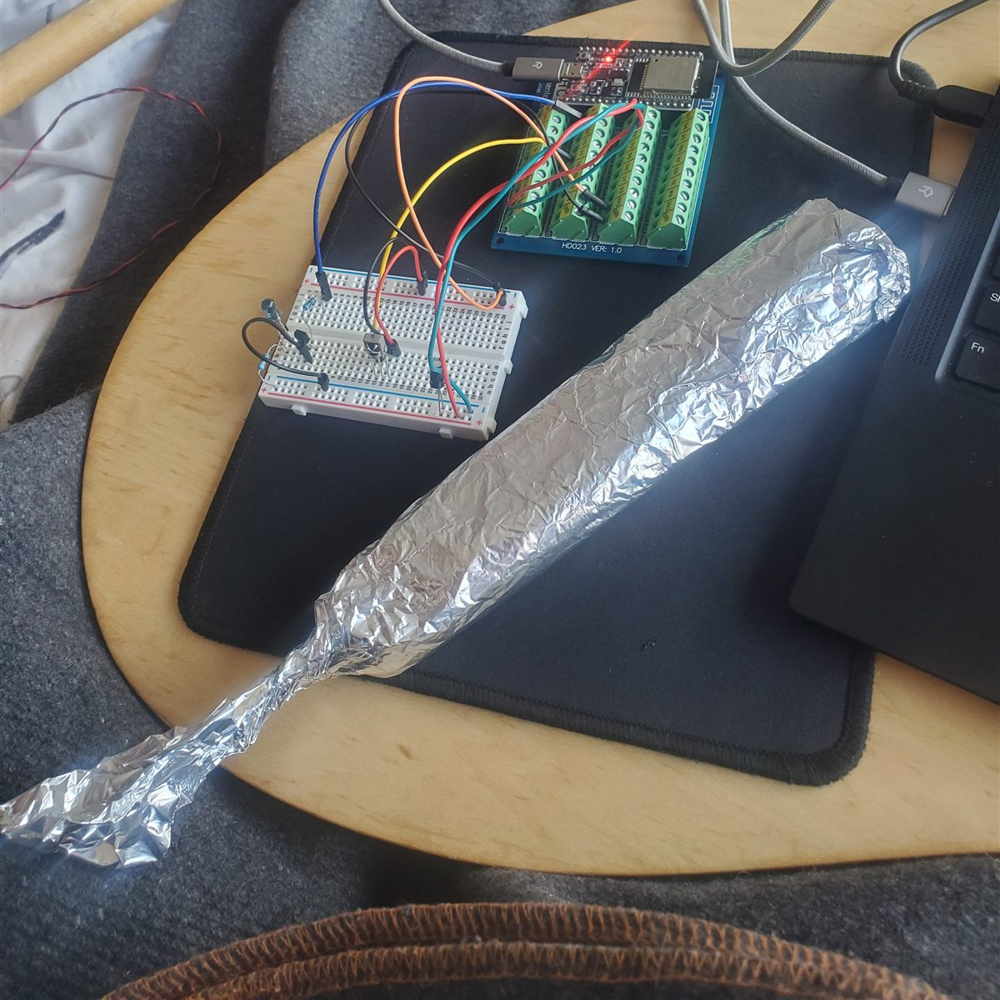
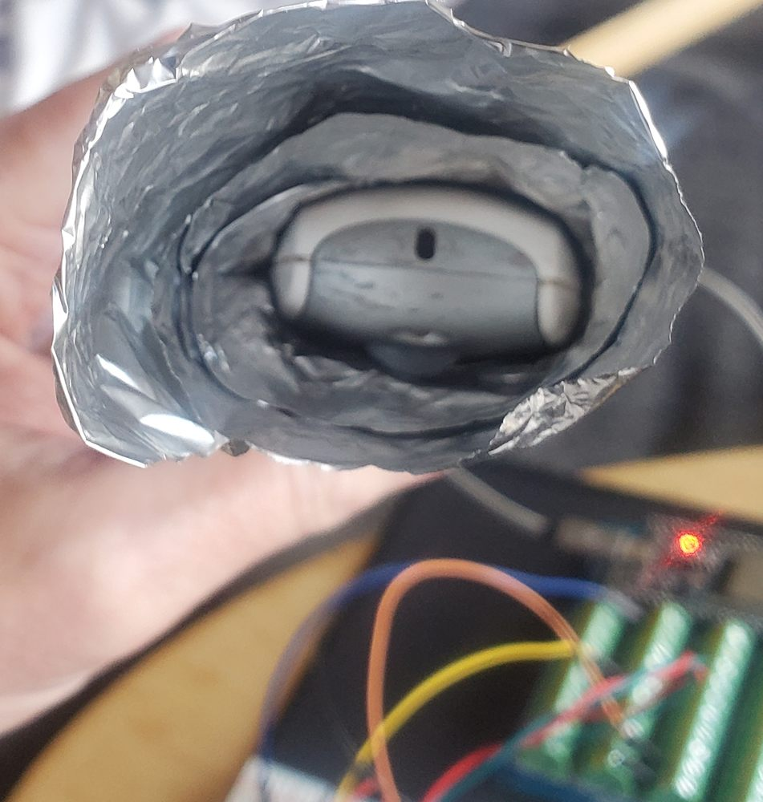
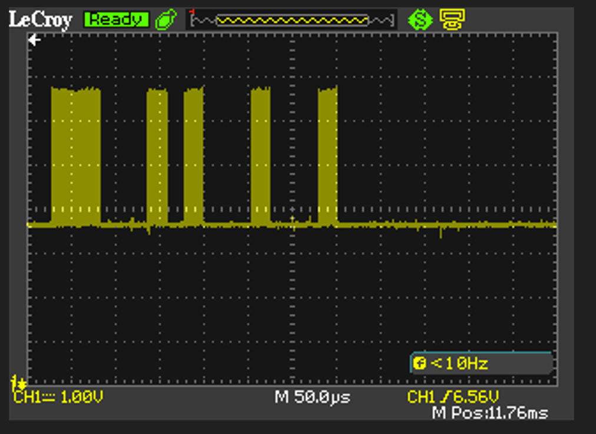
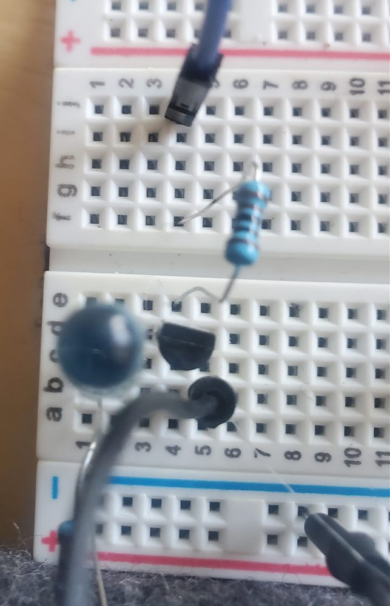
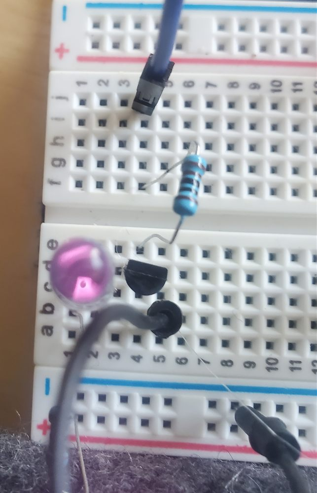
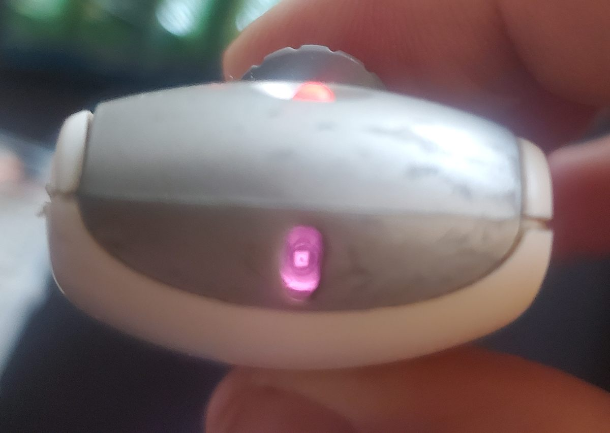
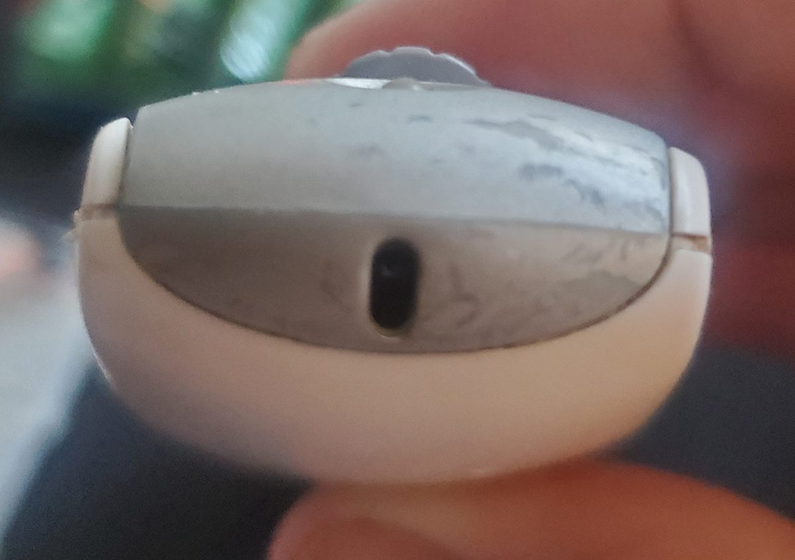

# HD Platinum IR protocol (point-and-press / red mode)

Reverse engineered on 2026-11-07 from the original Platinum remote. The source of truth in code is [`lib/hdcore/src/hd_ir.h`](../lib/hdcore/src/hd_ir.h).

| Status | |
|---|---|
| Frame format | ✅ decoded; matches the ESP32 capture and the logic analyzer |
| UP / DOWN codes, channel A | ✅ confirmed by both |
| UP / DOWN codes, channel B | ✅ ESP32 capture only (2026-11-08) |
| Other buttons | ✅ **none send IR in normal use**; only the up/down arrows transmit (logic analyzer, 2026-11-07). Setup-mode presses not captured yet. |
| Carrier frequency / duty cycle | 🔲 not measured (manual says 40 kHz) |
| Shade responds to synthesized frames | ✅ **yes, with the clone's own RF wake, no original remote** (2026-11-11), reliably with the LED about 1 ft from the sensor eye. Earlier: with the original remote's RF (2026-11-09); never with IR alone (0 of 20). See [Shade tests](#shade-tests) |
| RF needed alongside IR? | ✅ **shown by two independent tests** (2026-11-09): foil tube (remote's IR fails when its RF is blocked) and clone IR + remote RF. The RF was sniffed on 2026-11-11: a red-mode arrow sends `ID 01 00 80`, a wake frame with no direction. See [RF_PROTOCOL.md](RF_PROTOCOL.md) |

## When the remote sends IR

The remote has 7 keys: **UP, DOWN, 1, 2, 3, 4, ALL**, plus an **A/B slide switch**, which the manual calls the **Infrared Channel Selector**. It changes the IR code (see [Codes](#codes)). Each shade listens on one channel, and most are set to A (manual pp. 18, 22). Whether the switch also affects RF is unknown.

- **Group keys (1–4, ALL) are RF-only.** Pressing one always flashes the green LED and opens an **RF window of ≈ 6.5 s** (stopwatch measurement, 2026-11-07; the manual says 5 s). Pressing a group key again during the window **restarts** it.
- **The arrow keys are IR by default (red LED).** During an RF window they act as RF group commands instead (green). Once the window expires, they go back to IR.
- So IR is sent **only by UP or DOWN pressed with no recent group key**. Arrows pressed during an RF window send **no IR** (verified 2026-11-07 with the receiver and `ir quiet`).

The indicator light, per the manual (pp. 5, 7, 8, 17–20): red when an arrow sends IR; steady green on an arrow press during the group window; flashing green for about 30 s in setup mode, and after holding ALL for 6 s to set an intermediate stop; flashing red on a backup remote waiting to copy an original after a Master Reset; no light means flat batteries. In green mode, holding an arrow for 2 s is "express mode" (fully open or close, ignoring the intermediate stop; PowerRise only).

Not yet known:
- whether arrow presses extend the window
- whether the original sends its IR during or after its RF. Red-mode arrows send an RF wake frame while held (`ID 01 00 80`, see [RF_PROTOCOL.md](RF_PROTOCOL.md)); the relative timing hasn't been measured
- what IR is sent during the manual's setup procedures, which all end with an aimed arrow press: group assignment (p. 5), intermediate stop (p. 8), channel change (p. 22)

## Frame structure

A frame is a **header followed by 4 data bits, MSB first**. "Mark" means IR on (carrier bursts) and "space" means IR off. Data is **pulse-distance encoded**: every bit starts with the same short mark, and the length of the space after it gives the bit value.

| # | Part | Type | Duration |
|---|---|---|---|
| 1 | Header | mark | 2.75 ms |
| 2 | Header | space | 2.75 ms |
| 3 | Bit 3 (MSB) | mark | 1.03 ms |
| 4 | Bit 3 value | space | 1.03 ms = **0**, 2.75 ms = **1** |
| 5 | Bit 2 | mark | 1.03 ms |
| 6 | Bit 2 value | space | 0 / 1 as above |
| 7 | Bit 1 | mark | 1.03 ms |
| 8 | Bit 1 value | space | 0 / 1 |
| 9 | Bit 0 (LSB) | mark | 1.03 ms |
| 10 | Bit 0 value | space | 0 / 1 (also serves as the gap before the next frame) |

There is no stop bit and no extra gap between frames. The next header mark follows right after bit 0's space.

## Codes

| Switch | Button | Code (binary) | Hex | Header | Bit 3 | Bit 2 | Bit 1 | Bit 0 |
|---|---|---|---|---|---|---|---|---|
| A | Up arrow (OPEN) | `0101` | 0x5 | 2.75 / 2.75 | 1.03 / 1.03 | 1.03 / **2.75** | 1.03 / 1.03 | 1.03 / **2.75** |
| A | Down arrow (CLOSE) | `0110` | 0x6 | 2.75 / 2.75 | 1.03 / 1.03 | 1.03 / **2.75** | 1.03 / **2.75** | 1.03 / 1.03 |
| B | Up arrow (OPEN) | `1001` | 0x9 | 2.75 / 2.75 | 1.03 / **2.75** | 1.03 / 1.03 | 1.03 / 1.03 | 1.03 / **2.75** |
| B | Down arrow (CLOSE) | `1010` | 0xA | 2.75 / 2.75 | 1.03 / **2.75** | 1.03 / 1.03 | 1.03 / **2.75** | 1.03 / 1.03 |

(Each cell is mark / space in ms.)

The four codes fit a simple split, inferred from these four values only:

| Bits | Meaning | Values |
|---|---|---|
| 3–2 | IR channel | `01` = A, `10` = B |
| 1–0 | Command | `01` = OPEN, `10` = CLOSE |

Every code seen has exactly two 1-bits, so all frames are the same length.

In normal use, the arrows are the only keys that send IR (checked with the logic analyzer on channel A). This matches the manual: in point-and-press mode you stop a moving shade by pressing the opposite arrow, so there's no separate STOP code. The group buttons (1–4, All) only apply to RF mode.

It's unknown what the shades do with the 12 unused codes, or whether setup procedures use any of them. Sending unused codes at a shade is a possible experiment, at our own risk.

**Caution:** per the manual (p. 21), holding OPEN for 6 s while aimed at a fully open shade clears its stops and motor limits. A long IR send could do the same, so `send` limits OPEN codes to 5 s.

### Up arrow, `0101`

```
       header          bit3=0    bit2=1         bit1=0    bit0=1
 ┌─────────┐         ┌──┐      ┌──┐           ┌──┐      ┌──┐
 │  2.75   │  2.75   │1 │ 1.03 │1 │   2.75    │1 │ 1.03 │1 │   2.75    ┌─ next header
─┘         └─────────┘  └──────┘  └───────────┘  └──────┘  └───────────┘
   mark      space    m    s    m      s       m    s    m      s
```

### Down arrow, `0110`

```
       header          bit3=0    bit2=1         bit1=1         bit0=0
 ┌─────────┐         ┌──┐      ┌──┐           ┌──┐           ┌──┐
 │  2.75   │  2.75   │1 │ 1.03 │1 │   2.75    │1 │   2.75    │1 │ 1.03 ┌─ next header
─┘         └─────────┘  └──────┘  └───────────┘  └───────────┘  └──────┘
```

## Frame timing

| Component | Duration |
|---|---|
| Header (mark + space) | 2.75 + 2.75 = 5.50 ms |
| 4 bit marks | 4 × 1.03 = 4.12 ms |
| Spaces for a code with two 1-bits | 2 × 1.03 + 2 × 2.75 = 7.56 ms |
| **Total** | **17.18 ms** (measured: **17.19 ms**) |

UP and DOWN both have two 1-bits, so their frames are the same length. A code with a different number of 1-bits would be 1.72 ms longer or shorter per 1-bit.

## Button-press behaviour

```
press ────────────────────────────── hold ────────────────────── release
      [frame][frame][frame][frame] … [frame][fra┤ cut off
       17.19 ms each, back to back, all identical
```

- **Frames repeat back to back** for as long as the button is held (a 2.5 s hold ≈ 150 frames). A quick press sends about 20 frames (0.35 s).
- **Every frame in a burst is identical**: no toggle bit, no rolling counter, no checksum.
- **On release, transmission stops immediately**, even partway through a frame (seen in the analyzer captures). There is **no release or stop frame**.
- **No shade address:** whichever shade's sensor the remote is aimed at responds. This fits the manual's point-and-press description.

## Measured vs. nominal values

Measurements come from demodulating receivers (TSOP38238 / VS1838B), which distort mark and space lengths by tens of microseconds. The nominal values are what `send` transmits.

| Element | ESP32 capture (µs) | Logic analyzer @100 kHz (µs) | Nominal (µs) |
|---|---|---|---|
| Header mark | 2700–2750 | 2700–2750 | 2750 |
| Header space | 2750–2800 | 2750–2800 | 2750 |
| Bit mark | 990–1050 | 990–1050 | 1030 |
| 0-bit space | 1050–1100 | 1050–1110 | 1030 |
| 1-bit space | 2750–2800 | 2750–2800 | 2750 |

The decoder treats any duration above **1900 µs** as long (header or 1-bit space), well clear of both clusters.

**To refine:** probe the remote's IR LED drive (transistor base or LED cathode) with the logic analyzer at ≥1 MHz to get the true mark and space lengths, the carrier frequency and the duty cycle.

## Shade tests

All tests used one shade, with the remote's switch on A. The shade is a battery model converted to DC power, so it has the same electronics and firmware as a battery shade. The original remote operates it in red mode from more than 10 ft.

**These shades are top-down/bottom-up, and the arrows act reversed: DOWN opens, UP closes.** Before any shade test, put the shade mid-travel and check that the original remote moves it both ways. Otherwise a command can fail only because the shade is already at that end.

### Summary

**IR carries the command, and the shade also needs the remote's RF alongside it.** Two independent tests on 2026-11-09 agree:

1. **Foil tube:** the original remote moves the shade when bare, but not when sealed in a foil tube that blocks its RF while its IR still gets out.
2. **Clone IR + remote RF:** our synthesized IR never moves the shade on its own (0 of 20), but does whenever the original remote is pressed at the same moment with its IR aimed away. When the two disagree (clone UP, remote DOWN), the shade follows the clone.

So IR selects the shade and gives the direction, and our IR encoding is correct. The RF from a red-mode press doesn't override the IR's direction; it acts as an enable or wake-up. The sniff on 2026-11-11 fits this: the red-mode RF is `ID 01 00 80`, the remote's ID with no direction ([RF_PROTOCOL.md](RF_PROTOCOL.md)). A replacement should send that frame, with an ID the shade accepts, before each IR command.

This is the first hands-on evidence we know of for the RF wake-up claim, which until now existed only as secondhand forum reports.

**Clone only, 2026-11-11:** the clone's own RF wake followed by its IR moves the shade with no original remote involved.

### 2026-11-11: clone only (RF wake + IR)

The clone sends the wake frame `ID 01 00 80`, using the working remote's ID (set with `id`), for 450 ms. It rotates through ch 33/52/71, about 1,500 packets at roughly 300 µs each. The IR command (30 frames, 516 ms) follows with no gap, driven from the PC arrow keys. Both original remotes were out of reach. RF: one hiBCTR nRF24 module (marked `NRF24L01+`), no 10 µF cap, PA set to RF24's "high" level (−6 dBm on a genuine part). IR: one TSAL6200 at ~97 mA peak.

| Setup | Shade |
|---|---|
| Breadboard LED, aimed by hand | **moves, intermittently.** Better when held steady |
| LED on an extension lead (~6 ft of wire), about 1 ft from the sensor eye and 1 ft below it | **reliable:** sequences of up, stop, down, down, stop, up "with hardly a miss" |

**Reading.**
- The clone controls the shade on its own. The wake frame and the IR encoding are both right, and a wake with the working remote's ID is accepted.
- **Stops and same-direction repeats work** when each command gets its own wake, as the 2026-11-09 tests predicted.
- The misses track the aim, not the RF: steadier and closer aiming fixed them. So IR power and beam width are the limiting factors now. The TSAL6200's beam is narrow (±17°), and the shade's receiver appears less sensitive than ours.
- **Off-axis impression (user, unconfirmed):** the LED seemed to work best pointed slightly off what looked like "straight at the sensor eye". Possible causes: the receiver may sit behind the window at an angle or offset, or the LED's peak may be off its mechanical axis. Not yet tested.

**Interleaved sequence (same day).** The PC arrow keys were changed to send RF on ch 33 (50 ms), IR (170 ms, 10 frames), RF on ch 52, IR, RF on ch 71, IR: about 660 ms in all (`seq`). With the LED hand-held and aimed by eye, this **worked every time at more than 6 ft, and aiming felt much less critical** than with one 450 ms wake followed by 500 ms of IR. That's an impression, since hand shake varies the aim. A controlled comparison with a fixed mount is planned: an A/B test of the two patterns, then a sweep of the RF-to-IR gap to find how long the shade listens after a wake.

The leading explanation: the shade opens a fixed listening window when it first hears the wake. In the old pattern, much of the IR arrived late in that window. The interleaved pattern starts IR 50 ms after the RF and gives three fresh chances. It's probably also closer to the original, which appears to send RF and IR together while the key is held.

**ID control (same day):** with the wake carrying a made-up ID (`id 1234`), the shade ignored the clone. With the working remote's ID it obeyed. So the shade checks the ID in the wake ([RF_PROTOCOL.md](RF_PROTOCOL.md#what-the-shade-needs)).

**Not yet done:** the `wake off` control (IR only); exact trial counts; the maximum reliable range; the wake length the shade needs (450 ms copies the remote's shortest tap).

### 2026-11-09: clone IR + remote RF

Suggested by a reviewer as the direct test of both the wake-up and our IR encoding. Shade mid-travel. The clone's LED was aimed at the sensor eye and driven from the PC arrow keys (500 ms `up` / `down` bursts on channel A). The original remote, unmodified, was held in red mode with its IR window aimed away from the shade.

| Trial | Shade |
|---|---|
| Remote alone, aimed away, about 10 presses of each arrow (control: no stray IR reaches the shade) | no response |
| Clone alone, 10 UP + 10 DOWN (control: IR alone) | **no response, 0 of 20** |
| Clone + remote pressed at the same time, same direction | **moves**, both directions |
| Clone UP + remote DOWN (and the reverse) | **follows the clone** |

**Reading.**
- Our synthesized IR is accepted, so the frame format and codes in this document are right (acceptance A2, with RF present).
- IR alone fails and IR with the remote's RF works: the second, independent confirmation that the shade needs RF alongside IR.
- The shade obeys the IR's direction when the two disagree, so the red-mode RF acts as an enable, not as the command.
- The remote was aimed away, and its own presses moved nothing, so the clone's IR is what the shade decoded.

**One RF enable, one IR command, within a second** (follow-ups, same session):

| Question | Result |
|---|---|
| Second clone command after one is accepted (e.g. UP after DOWN)? | ignored until a remote arrow is pressed again; either arrow works |
| Same direction twice (DOWN, DOWN)? | also needs a new remote press |
| Opposite arrow while the shade moves ("stop")? | ignored without a new remote press |
| Delay between the remote press and the clone's IR | must be short: **under about 1 s** (rough, by hand) |

So the RF arms the shade for a single IR command, briefly. A replacement must send its RF enable immediately before **every** IR command, stops and repeats included, as the original remote presumably does on each red-mode press.

**Still to measure:** the exact receptive window and the original remote's RF-to-IR timing (logic analyzer on its nRF24 and LED drive, or our sniffer plus IR receiver), and the exact number of combined trials.

### 2026-11-09: foil tube ("burrito")

 

**Method.** The remote was sealed in a long aluminium foil tube, about 5 cm across (estimated from the photo), with the back end twisted shut and the front end open. IR leaves through the open end. 2.4 GHz should be attenuated, because a round metal tube only passes it if it's wider than about 7 cm (waveguide cutoff), and the remote sits some way back from the mouth. Buttons were pressed through the foil.

**Why a tube.** Smaller covers leak. With a hand wrapped around the remote's front, our receiver still decoded 14–18 of 20 frames per press (log Part 1). Our 2026-11-08 attempts with a hole in a full wrap couldn't separate the links either (see below).

**IR gets out (receiver checks, `ir quiet`, log Parts 2 and 3).**

| Burrito position | Result |
|---|---|
| Open end aimed at the receiver, 30 cm (two runs) | 14 of 14 presses decoded cleanly, 20 frames each (one 24-frame longer press), no bad frames |
| Pointed up, 90° off axis, 30 cm | 6 of 6 clean, probably by reflection from nearby surfaces |
| Pointed into free space away from the receiver | nothing in about a minute |
| Swept up and down out of the receiver's plane | mostly clean near the axis, some presses at 17, 10 or 6 frames, and no valid frames at the extremes |

**Shade results** (shade with travel available, about 30 cm from the sensor eye):

| Remote | IR out | RF out | Shade |
|---|---|---|---|
| Bare, red-mode arrow | yes | yes, if it sends any | **moves** |
| Wrapped, red-mode arrow, aimed at the sensor eye | yes, decoded cleanly at the same 30 cm | blocked | **no response** |
| Bare, group key + arrow (green mode) | none (green mode sends no IR) | yes | **moves** |
| Wrapped, group key + arrow | none | blocked | **no response** (the RF control: the foil blocks RF) |

The bare, wrapped, bare sequence was repeated with the same results. Exact trial counts weren't recorded.

**Reading.** The same remote, distance and code worked bare and failed wrapped. The foil can't change the IR's code or timing, and our receiver confirmed the IR reaches 30 cm cleanly, so the difference we can show is that RF was blocked.

**Caveats.**
- The tube narrows the IR beam compared with the bare remote. The clean decode at the same distance makes this unlikely to matter.
- The shade's receiver may be less sensitive than ours (TSOP38238 / VS1838B type). It ignored IR at a distance where ours decoded every frame, and the bare remote works from more than 10 ft.
- The RF wasn't observed during this test. It was sniffed later (2026-11-11, [RF_PROTOCOL.md](RF_PROTOCOL.md)).

**To repeat it.** Record the tube's opening width and how far back the remote sits, and mark the insertion depth on the remote. Re-run the green-mode control after any rewrap. Check that IR gets out with a receiver at the same distance as the shade.

### 2026-11-08: synthesized IR and foil with a hole

**Synthesized IR.** `send down 10000` with a TSAL6200 at about 1 ft, aimed in several directions around the sensor eye. The shade did not move. **This test was flawed:** the shade was open and DOWN opens these shades, so it may have had no travel available. A failure is consistent with the foil-tube result, but this test doesn't show it on its own.



The scope across the 33 Ω LED resistor showed about 3.2 V p-p (about 97 mA peak) and the expected frame: header, then marks with short and long spaces. The burst tops are flat, so the supply holds up. The on-screen timebase reads 50 µs/div, which doesn't match the trace (individual 40 kHz cycles would be visible at that setting), so treat its horizontal scale as unknown.

   

Phone camera views of the clone LED (off, sending) and the original remote's single IR window (sending, idle). A camera only shows that an LED emits; it can't compare output or show that a cover blocks IR.

**Foil wrap with a hole**, operated through the foil:

| Shield | RF (group key + arrow) | IR (red-mode arrow) |
|---|---|---|
| Fully wrapped | no response | not applicable |
| Small hole showing the whole LED face | no response | no response at about 30 cm |
| Hole about 1.5 cm across | **works** | works |

The small-hole result agrees with the foil tube, but on its own it was weak: the IR leaving the hole was never checked, and the travel issue above applies. A 1.5 cm hole is small compared with the 12.5 cm wavelength but still leaks enough RF to work, so always run the RF control for each shield.

### Next

1. **Clone alone:** ✅ works (2026-11-11, above). Still to run: controls with `wake off` (IR only) and an ID the shade doesn't know; then improve IR range (a second LED, a wider-angle LED, or a test of the off-axis aim).
2. **Receptive window, and `seq` on vs off.** With the LED on a fixed mount at a marginal aim (missing about half the time): compare `seq off` with `seq on` over at least 10 presses each, logged `# y` / `# n`. Then sweep `seq gap` 0, 100, 200, 400 and 800 ms. A sharp drop past some gap gives the shade's listening window after the RF.
3. ~~**nRF24 sniff**~~ Done 2026-11-11: red-mode presses send `ID 01 00 80`, as predicted. See [RF_PROTOCOL.md](RF_PROTOCOL.md).
4. **Measure the foil directly** with a module at the tube's mouth, remote bare vs. wrapped.
5. **Probe the remote's own LED drive** for the true carrier frequency, duty cycle and timings.

## Evidence

| File | What |
|---|---|
| [`captures/ir_red_open_close_20261107_132807.log`](../captures/ir_red_open_close_20261107_132807.log) | ESP32 capture, short presses: 5 bursts, codes `0101` / `0110` |
| [`captures/ir_red_hold_open_then_close_20261107_133330.log`](../captures/ir_red_hold_open_then_close_20261107_133330.log) | ESP32 capture, ~2.5 s holds |
| [`captures/la_ir_red_up_arrow_20261107.sr`](../captures/la_ir_red_up_arrow_20261107.sr) | PulseView, up arrow: 150 × `0101`, last frame cut off at release |
| [`captures/la_ir_red_down_arrow_20261107.sr`](../captures/la_ir_red_down_arrow_20261107.sr) | PulseView, down arrow: 74 × `0110` |
| [`captures/ir_ab_channel_20261108.log`](../captures/ir_ab_channel_20261108.log) | ESP32 capture: captures 1–4 switch on A, 5–8 on B |
| [`captures/ir_shield_tests_20261109.log`](../captures/ir_shield_tests_20261109.log) | ESP32 captures for the foil-tube tests: hand over the remote (Part 1), tube aimed and off axis (Part 2), tube at 30 cm (Part 3) |
| [`docs/images/`](images/) | Photos of the foil tube, the remote's IR window, the clone LED, and the scope trace of the clone's LED drive |

The receiver OUT was on GPIO 32 for the Nov 7 ESP32 captures, GPIO 14 from Nov 8, and on analyzer D0 for the PulseView captures. The analyzer files open in PulseView, and the serial logs are plain text.

## Firmware support

- `ir` / `ir quiet`: capture and print a decoded summary per burst, e.g. `HD: code=0101 (A UP) frames=147 other=0 duration=2.53 s`.
- `send up|down|bbbb [ms]`: send the RF wake (if a remote ID is set with `id`; `wake off` disables it), then synthesize and transmit frames at 40 kHz for about `ms` (default 1000). `up` and `down` are channel A; use `1001` / `1010` for B. OPEN codes are limited to 5000 ms and others to 10000 ms. `play` replays raw captures and has no such limit.
- PC Up/Down arrow keys in the serial monitor send the wake, then `up` / `down` for 500 ms per press.
- Lines starting with `#` are comments: echoed to the log, and they don't stop a running capture. Use them to annotate tests.
- Codec: `hd::ir::encodeFrame`, `encodeBurst`, `decodeFrames`, `summarize` in [`hd_ir.h`](../lib/hdcore/src/hd_ir.h), tested in [`test/test_native_ir`](../test/test_native_ir/test_main.cpp) against real captured frames.
