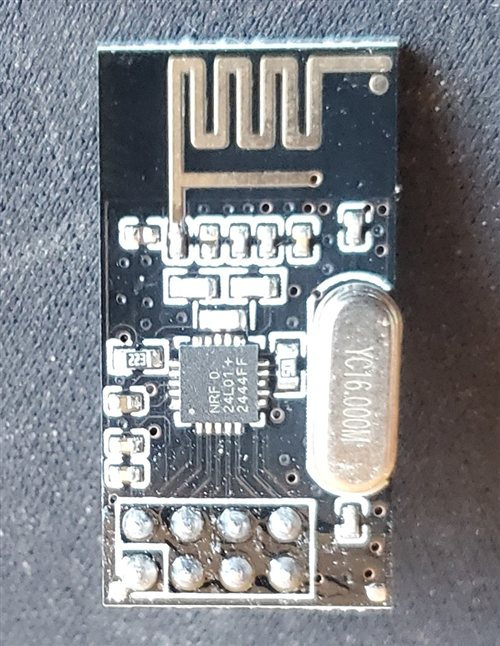

# nRF24 module wiring

How to connect 2×4-header nRF24L01+ modules with a PCB antenna to an ESP32-DevKitC for this project's firmware.

**Status:** the GPIO assignments come from [`include/pins.h`](../include/pins.h) and `src/rf_tools.cpp`. The header layout comes from the seller's drawing for our modules (hiBCTR "24L01-NA"). On 2026-11-11 we checked it against one of our modules: the silkscreen matches, and the diode check below confirmed which pins are GND and VCC. The signal pins (CE through IRQ) aren't confirmed until a module passes `test`. Modules vary, so check yours before applying power.

## Module header

The header is 2×4 at 2.54 mm pitch, at the end of the board away from the antenna. Its long axis runs across the board's width. Seen from the component side, with the antenna at the top:

```
          antenna
 ┌─────────────────────────┐
 │  VCC   CSN   MOSI  IRQ  │  row nearer the antenna
 │ [GND]  CE    SCK   MISO │  row at the board edge
 └─────────────────────────┘
   [ ] = square pad, pin 1
```

Board size per the seller's drawing: 15.2 × 28.5 mm.



One of our modules (hiBCTR), component side, in the same orientation as the drawing above. The pin-1 square is the silkscreen box around the bottom-left header pin, the corner pin farther from the 16 MHz crystal. The chip is marked `NRF24L01+` / `2444FF`. Clone chips often carry the same marking, so this doesn't show whether ours is genuine.

The header pins come out the **back** of the board, so seen from the side where you plug in jumpers, the layout is mirrored left to right. Find the square pad on the front, and mark the GND wire before plugging in.

**Before powering a module:**

1. Find the square pad. It should be GND. If your board has pin labels, trust those over this drawing.
2. Confirm with a multimeter in diode mode, unpowered. Put the red probe on GND (the square pad) and the black probe on VCC (the pin next to it). It should read a diode drop, through the chip's internal protection diodes; our module read 0.54 V. Swapped, it should read open. If you get the opposite, your module's labeling differs. Continuity alone isn't proof, and on our module the crystal can isn't grounded.
3. Confirm that VCC goes to **3.3 V**. These parts are rated to 3.6 V at most, so 5 V can destroy them.

The header doesn't fit a breadboard directly, because each pin pair would be shorted across one breadboard row. Use female-to-male Dupont jumpers (single-pin housings fit side by side), or an adapter board.

## Connections

Keep SPI wires short, under about 15 cm.

### Radio A: main module (VSPI)

| Module pin | Signal | ESP32 |
|---|---|---|
| 1 | GND | GND |
| 2 | VCC | 3V3 |
| 3 | CE | GPIO 17 |
| 4 | CSN | GPIO 5 |
| 5 | SCK | GPIO 18 |
| 6 | MOSI | GPIO 23 |
| 7 | MISO | GPIO 19 |
| 8 | IRQ | GPIO 16 (reserved; the firmware doesn't use it yet, so it can stay unconnected) |

### Radio B: optional second module for loopback (HSPI)

Used only by `beacon` and the loopback device test. Set `HW_NRF24_B` in [`include/hw_config.h`](../include/hw_config.h) when it's wired.

| Module pin | Signal | ESP32 |
|---|---|---|
| 1 | GND | GND |
| 2 | VCC | 3V3 |
| 3 | CE | GPIO 21 |
| 4 | CSN | GPIO 13 |
| 5 | SCK | GPIO 25 |
| 6 | MOSI | GPIO 27 |
| 7 | MISO | GPIO 26 |
| 8 | IRQ | not connected |

HSPI is remapped because its default SCK (GPIO 14) is our IR receiver and its default MISO (GPIO 12) is a boot strapping pin.

On WROVER boards, GPIO 16 and 17 are used by PSRAM, so radio A's CE and IRQ must move.

## Power

Fit a 10 µF capacitor across VCC and GND for each module, as close to the module as you can, with the stripe (−) to GND. Soldering it to the back of the header across pins 1 and 2 works well.

## Checking a module

1. `test <label>`: register read-back over SPI. This shows the module answers, not that its radio works.
2. `beacon` (with radio B wired): radio B transmits and radio A receives. This proves the radio link between two modules, but two clones could share a quirk.
3. Sniffing the original remote is the real proof that a module can hear it.
