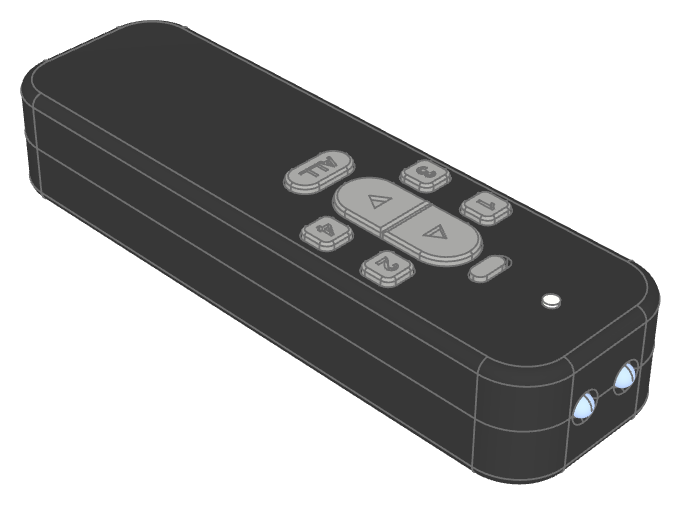
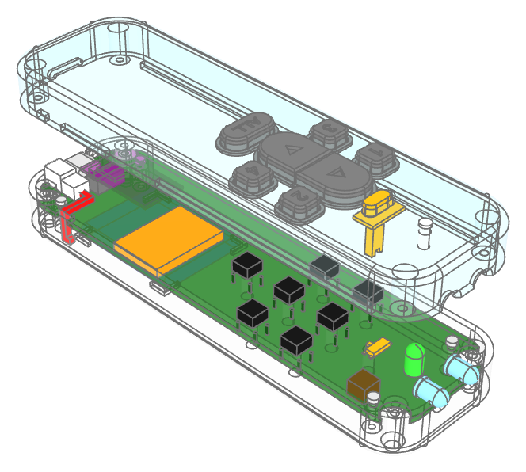
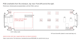
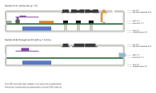

# Enclosure (3D-printed)

Code-CAD models for the handheld's case and test prints, written in Python with [build123d](https://github.com/gumyr/build123d). Each part is a script that produces STEP and STL files.

Status (2026-11-13), preliminary: `parts/remote_box.py` models the case as a two-part clamshell (`bottom`, `top`) plus 7 keycaps (`caps`), 150 × 45 × 27 mm, with standoffs, key pads, IR LED and USB-C openings, key and indicator holes, and a lip. Keycaps and battery ribs are modelled; the A/B slider is a placeholder in `assembly.py`. Internal parts (board, LEDs, USB, ESP32, nRF24, battery) exist only as placeholder previews used for clearance checks.

## Decisions

| Date | Decision | Why |
|---|---|---|
| 2026-11-13 | **Material: MJF nylon (PA12)**, printed by JLC (John) | Tough rather than brittle; takes self-tapping screws and heat-set inserts |
| 2026-11-13 | ~~Lid 2 mm thick, with a lip~~ superseded by the clamshell below; the key face stays 2 mm and the lip moved to the top shell | |
| 2026-11-13 | Key layout (preview): indicator 14.8 mm from the front, UP 32, DOWN 49 (13 × 26 mm), keys 1–4 in a row at 68 (7 × 7 mm, 9.6 mm pitch), ALL at 82 (8 × 22 mm); centres measured from the IR end | Arrows under the thumb while aiming; group keys just behind them, since an arrow follows within the ~6.5 s window; ALL apart to avoid stray presses |
| 2026-11-13 | **Board mounting: 4 separate standoffs** (5 mm, M2 self-tappers through the board, 122 × 31 mm apart), not shared with the 4 case posts | Most robust; the case can be opened without disturbing the board |
| 2026-11-13 | **Support pads under each key switch** (3.5 mm, 0.1 mm below the board, no board holes) | With support only at the corners, ~140 mm apart, a ~5 N press would flex a 1.6 mm board by roughly 1 mm (beam estimate): mushy keys, stressed solder joints. Pads only need a keep-out on the board's underside, between the switch pins |
| 2026-11-13 | **Battery under the board**, on the floor of the back section; placeholder cell 503035 (5 × 30 × 35 mm, ~500 mAh; replaced by the chosen cell, see 2026-11-14), 92–127 mm from the front. Board raised so its underside is 7.5 mm above the floor (swollen cell 5.5 + pin tips 1.5 + 0.5) | A 1000 mAh cell on top of the board took two-thirds of the back section, where the ESP32, nRF24, charger and USB parts must go, and it hit the board screws. Use is under ~1 mAh/day (estimate), so ~500 mAh is ample |
| 2026-11-13 | **Clamshell split at the IR LED axis** (14.1 mm above the bottom): bottom shell with floor, standoffs and pads; top shell with the key face and a lip along the long sides. M2 × ~8 screws from underneath (counterbored) into bosses in the top shell. USB-C opening a rounded rectangle (straight sides) | The LEDs and USB-C reach into the end walls, so the board couldn't go into an open-top box (149 mm of board and parts vs 146 mm inside). Open-top notches closed by lid tabs worked but left 11–12 mm notches and long thin tabs at both ends. The split keeps the ends solid with one straight seam; straight-sided USB opening avoids an undercut, since the USB centre is 1.4 mm below the split |
| 2026-11-13 | **IR LEDs 1.5 mm proud**, with a 1 mm × 45° countersink. Reviewed and **kept for version 1** (John): most IR margin first; the front end is exposed in a drop, so if drops damage them, the fallback is flush tips with a deeper/wider countersink | Guarantees the wall can't clip the beam's edges (the LED's own lens sets its ±17° beam). The original has one LED behind its tip; we have two |
| 2026-11-13 | **USB-C receptacle recessed 1 mm** behind the outer face; nRF24 socket at least 4.5 mm from the USB pads | Flush, the front shell-leg pads hung 0.5 mm off the board edge; the socket was 0.46 mm from the USB pads, leaving no room for D+/D−/CC/VBUS |
| 2026-11-13 | **Top face follows the original Hunter Douglas layout**: indicator at the tip, CHANNEL A/B slider (printed knob and fork over an MSK12C02 / PCM12 side-actuated switch, 1.5 mm travel), one oval for the UP/DOWN arrows (two caps, two switches), groups 1/2 and 3/4 beside the arrows, ALL below. SETUP is a floor pinhole 22 mm from the front, over a 5 mm switch on the board's underside (moved 10 mm right of centre on 2026-11-13, see below) | Familiar to anyone who has used the original (manual pp. 3–5 photos); 8 mm shorter key area than our first row layout |
| 2026-11-13 | **Keycaps**: separate parts with a 1 mm × 0.8 mm retaining flange under the face, 1.5 mm proud, clear of the switch plungers (see the review changes below for the play and legend depth); legends recessed (▲/▼ on the arrows, bold 1–4 and ALL reading upright with the remote pointing away) | Caps can't fall out; no preload on the switches |
| 2026-11-13 | **Finish: natural grey shells, dyed-black caps and A/B knob, legends filled with white paint** (John) | Close to the original's dark keys on a light body; recessed legends on black caps need the fill to be readable |
| 2026-11-13 | **Corner radius 12 mm** (was 4); corner posts move onto the corner diagonal, lip stops where the side walls start to curve | Softer, more tapered look. A sweep (4–14 mm, all fit checks at each) found 12 the largest that keeps the IR LED countersinks on the flat part of the front wall; 14 puts them on the curve |
| 2026-11-13 | **Top and bottom perimeter edges rounded 2.5 mm** (smaller than the 12 mm vertical corners) | Softer in the hand and less boxy; 1.8 mm of material remains through the curve with the 2 mm wall (measured). Much above ~3 mm the wall gets thin there |
| 2026-11-13 | **Battery held by four L-shaped corner ribs** on the floor (1.5 mm tall, 1 mm thick, 6 mm legs, 0.5 mm clearance) plus a thin (≤ 0.2 mm) double-sided tape pad; an insulating sheet (Kapton or fish paper) on the board's underside over the cell | Locates the cell without clamping it; open sides leave room for the leads, removal and swelling. Vertically the cell is already trapped between the floor and the board. Thick foam tape would push a swollen cell into the pin-tip allowance |
| 2026-11-13 | **Review changes** (external review of the first cut): legends recessed **0.8 mm** (was 0.4), digits 4.5 mm and ALL 4.0 mm; keycap play at rest **0.3 mm** (was 0.1), with a 0.2 mm relief pocket in each flange over the plunger so the flange stays 0.8 mm; an **outside pocket round the USB-C opening** (12.5 × 7 mm, 1 mm deep) so a plug's moulded housing can sink in by the 1 mm recess | MJF's grain fills fine recesses (≥ 0.8 mm wide × deep is the guideline the review cited); ±0.3 mm per part can eat a 0.1 mm gap, and shims under the board can only reduce it, so start large and tune on the print; without the pocket a plug housing hits the case 1 mm before the plug seats. All three get test-print samples |
| 2026-11-13 | **SETUP pinhole 10 mm right of centre** (`SETUP_Y = -10`), still 22 mm from the front | Found at PCB placement: on the centre line, the underside SETUP switch's through-hole pins land on the A/B switch's pads (26 mm), and nowhere between A/B and the indicator (14 mm) fits a 6 mm switch without hitting one of them. KiCad DRC is clean from 8 mm off-centre; 10 leaves margin. The case checks can't see this kind of clash, since the parts sit on opposite sides of the board |
| 2026-11-13 | **ESP32 antenna end at the −Y (right-hand) board edge**, was +Y; the lip gap moved with it (`LIP_GAPS`) | Found at PCB routing: the key GPIOs must be RTC pins, all in the module's left pin column, which faced the back; the nRF24 SPI pins faced the front. Rotating the module 180° stops the two bundles crossing. All 51 case checks pass |
| 2026-11-14 | **Cell chosen (John): Adafruit #1578** (500 mAh, 29 × 36 × 4.75 mm). Model now `BATT_W, BATT_L = 29, 36` (rib pocket 30 × 37 mm); `BATT_T` stays 5.0 as a thickness allowance; front edge still 92 mm from the front, so the cell now ends 128 mm from the front | In stock, protected, documented JST-PH polarity, rated for our ~256 mA charge. Keeping `BATT_T` leaves the board height, and the ordered test piece, unchanged. The board's battery keep-out grew 1 mm toward the back to match. Measure the real cell on arrival and set the ribs from it. All 51 case checks pass |
| 2026-11-14 | **Charge LED window**: a 1.6 mm hole through the back wall at Y +7.75 (`CHG_Y`), 0.3 mm above the board top (`CHG_Z`), in the bottom shell | The charge LED is now a side-view part at the board's back edge (the case had no window for the old top-view LED). The hole sits on the flat wall (edge 8.6 of ±10.5 mm) and 0.7 mm clear of the USB-C plug pocket. Three new checks; all 54 pass |
| 2026-11-15 | **Keys 1–4 are rounded squares** (8 × 8 mm, `KEY_CORNER_R` 2 mm; were 8 mm circles) | A round cap in a round hole can turn, and its number with it; the corners stop it, leaving a few degrees of play at the 0.3 mm clearance. `assembly.py` now fails if any key outline is a circle. The ordered test piece still has a round 8 mm cap: its results for plunger play, clearance and feel still apply |
| 2026-11-15 | **Indicator through a light pipe** (John): the WP59EGW LED sits flush on the board and a Bivar PLP2-250 (3 mm, 6.35 mm long, 3.3 × 0.8 mm head) presses into a `PIPE_HOLE_D` 2.92 mm hole in the key face; the old 5.2 mm hole for a 5 mm LED standing 2 mm proud is gone. `assembly.py` checks the pipe-to-LED gap (0.95 mm; 0.5–1.5 wanted) and the face thickness against the pipe's panel range | A free-standing LED needed ~9 mm of bare lead and a spacer to hit its height, and stuck out of the face. Flush LED + pipe: each part has one fixed position, nothing to adjust, a low head that suits drops. MJF hole size varies more than the pipe's +0.08/−0.05 mm fit window: test-fit on the next print, glue if loose |
| 2026-11-15 | **Battery pocket 31 mm** (`BATT_W` 30): the cell datasheet says 30 ± 0.1 mm wide, not Adafruit's 29 | 0.5 mm play per side for a 30 mm cell, 1.0 for 29; never a press fit. Board keep-out was already 31 mm. Measure the real cell, including the protection-board bulge |
| 2026-11-14 | **A/B slider drive: a solid block with a notch** (`AB_BLOCK_T, AB_BLOCK_W = 2.4, 4.6`, `AB_NOTCH_PLAY = 0.15`), replacing the thin stem with two 1.2 × 1.6 mm prongs | The prongs were fragile in MJF PA12, most at risk in blind assembly (the fork must land round a 1.3 mm actuator you can't see) and in drops. The notch walls are now 1.5 mm wide and the block's full 2.4 mm thick; the block stays inside the switch body's width at both ends of travel, clear of its mounting legs. New check: the notch holds the actuator with 0.15 mm play each side; all 55 pass. **Deferred until the test print shows real fit and finish** (John: a little sloppy is fine for the first one): make the slot the hard stop (knob travel = switch travel + notch play, ~1.8 mm, instead of 2.1, so end-of-travel force goes into the case, not the switch) and a ~0.3 mm × 45° lead-in chamfer on the notch mouth |

PCB layout constraints from the case so far: 4 × 2.2 mm holes at (±61, ±15.5) mm from the board centre with ~5.5 mm head keep-outs; board outline with 9.7 mm corner radii (following the inner wall, 0.3 mm gap) and notches (radius 4 mm) around the case posts at (±67.9, ±15.4) mm; **IR LED axis on the split plane** (footprint LED_D5.0mm_Horizontal_O1.27mm_Z3.0mm: axis 3.0 mm above the board top), LED pads 8.4 mm from the front with the tips 1.5 mm proud; USB-C face 1 mm inside the back face, board edge 0.3 mm from the inside wall; lip gap in the top shell wherever a part reaches the board edge near the split (now: the ESP32 antenna end, at the −Y edge since 2026-11-13); **battery leads**: a notch in the right-hand (−Y) board edge, 128–133 mm from the front and 3 mm deep, for the leads to pass from the cell under the board to the JST PH socket (S2B-PH-K, side entry) on top, mouth facing the front at 140 mm, centred 9 mm right of the centre line; the lip has a gap there too; bottom-side keep-outs (~4 mm) under each key switch for the pads; SETUP switch on the underside at 22 mm from the front, 10 mm right of centre; **no THT pins over the battery** (92–127 mm from the front, ±15 mm), or trim them flush, since only 0.5 mm separates pin tips from a swollen cell. Board top surface 11.1 mm above the case bottom, leaving 13.9 mm to the underside of the key face (nRF24 on a standard socket with the module measured 2026-11-16: 15.8 mm, 1.9 mm into the face; **decided 2026-11-16 (John): Samtec SLW-104-01-G-D**, 4.57 mm, module pins trimmed: 11.9 mm, 2.0 mm clear. Open: a hold-down rib for drops).

## Setup (Windows)

The virtual environment lives **outside Dropbox**. Dropbox locks files while pip writes them, which breaks the install, and OCP alone is several hundred MB.

```powershell
python -m venv $env:USERPROFILE\.venvs\hd_enclosure
& $env:USERPROFILE\.venvs\hd_enclosure\Scripts\python.exe -m pip install -r hardware\enclosure\requirements.txt
```

Tested with Python 3.11.9.

## Viewing models in VS Code

1. Install the **OCP CAD Viewer** extension (`bernhard-42.ocp-cad-viewer`).
2. Select the interpreter `~\.venvs\hd_enclosure\Scripts\python.exe` (Ctrl+Shift+P → *Python: Select Interpreter*). PlatformIO is unaffected; it uses its own Python.
3. Open the viewer (OCP CAD Viewer icon in the activity bar), then run a part script. A script calls `show(...)` from `ocp_vscode` to send its model to the viewer.

## Fit checks: `assembly.py`

`assembly.py` builds the case from `parts/remote_box.py`, adds placeholder models of the parts inside (board, switches, IR LEDs, USB-C, ESP32, nRF24 on its socket, battery, A/B slider, SETUP switch, indicator, keycaps) and runs every fit check: clearances, key-face webs, keycap travel and retention, legends, the A/B slider at both ends, openings on the flat end walls, USB-C routing room, and nRF24 headroom. It exits non-zero if any check fails, so run it after every change.

```powershell
$py = "$env:USERPROFILE\.venvs\hd_enclosure\Scripts\python.exe"
& $py hardware\enclosuressembly.py                          # checks + exploded view
& $py hardware\enclosuressembly.py --explode 0 --top-alpha 0.2   # assembled, see-through top
& $py hardware\enclosuressembly.py --finish                 # grey shells, black keys, white legends
& $py hardware\enclosuressembly.py --sweep CORNER_R 8 10 12 14   # rebuild + check per value
```

The internal parts are placeholders positioned from the layout explored on 2026-11-13; replace them with the board's STEP export once the PCB is laid out.

## Case assembly

After the board is assembled (see `docs/HARDWARE.md`, Board assembly):

1. Stick a thin (≤ 0.2 mm) double-sided tape pad on the floor and press the cell down between its four corner ribs, leads toward the back.
2. Put Kapton tape or fish paper on the board's underside over the cell area.
3. Feed the battery leads up through the notch in the right-hand board edge. Lower the board onto its four standoffs and fit the M2 self-tapping screws.
4. Plug in the battery JST and the nRF24 module.
5. Set the A/B switch on the board to A. Drop the keycaps (flanges down) and the A/B slider (knob at A) into the top shell from inside.
6. Lower the top shell onto the bottom (the slider's fork lands round the switch actuator), turn it over, and fit the four M2 case screws from underneath.

## Test piece: `parts/test_piece.py`

One small MJF print that replaces the model's placeholder values with measured ones. All sizes come from `remote_box.py`, so the samples test what the case uses. `python parts/test_piece.py --export` runs its checks (23) and writes STL and STEP files to `out/` (not committed; rerun to regenerate). Order in **MJF PA12, natural grey**, the case material. **First print ordered 2026-11-13 from JLC3DP** (STLs exported from commit `76482ef`; all seven meshes checked watertight).

| Sample | How to test | Sets |
|---|---|---|
| IR LED holes 5.2 / 5.4 / 5.6 mm, with the outside countersink | Push a TSAL6200 into each from inside: want a snug slide, no wobble, no force | `LED_HOLE_D` |
| USB-C opening + outside pocket | Push each of your real USB-C cables in from outside: the plug housing should sit in the pocket. Final seating is checked on the first board, with the receptacle 1 mm inside the wall | `USB_POCKET_*`, `USB_RECESS` |
| Screw bosses, pilots 1.6 / 1.8 / 2.0 mm | Drive an M2 self-tapper into each: want firm threads, no splitting, removable | `SO_HOLE_D`, `PILOT_D` |
| SETUP pinholes 1.4 / 1.6 / 1.8 mm | A straightened paperclip should pass freely, a fingertip shouldn't press anything | `SETUP_HOLE_D` |
| Legends 0.4 / 0.6 / 0.8 mm deep | Fill with white paint, scrape, compare legibility | `LEGEND_DEPTH`, sizes |
| Key stack: base + face + caps marked .0 / .1 / .2 / .3 (mm of play) | Fit one 6 mm × 13 mm tactile switch (legs through the base), screw on the face, try each cap: want no click at rest and a crisp click without a dead zone | `CAP_PLAY` |

The key fixture reproduces the case's 0.90 mm plunger-to-face gap, so the best cap's play transfers directly. Shims under the board can only reduce the play in the real case.

## Views

Generated from the model by `views.py` into [`docs/images/enclosure/`](../../docs/images/enclosure/); rerun it after a change (the shaded views need OCP CAD Viewer open, or pass `--no-shots`). Internal parts are placeholders until the PCB is laid out.

| | |
|---|---|
|  |  |
| Finished look: natural-grey MJF shells, dyed-black keys, white-filled legends | Exploded: top shell (with keycaps and A/B slider) lifted 30 mm |

**PCB constraints** (top view, front end at the right): board outline, case-post notches, battery-lead notch, standoff holes with screw-head keep-outs, part positions, and keep-outs on the underside.



**Sections** through the centre line and through an IR LED, with heights above the outside bottom.



**Top, bottom and end views** (hidden edges dashed in the top and bottom views): [`enclosure_views.svg`](../../docs/images/enclosure/enclosure_views.svg).

**Board outline for KiCad:** [`enclosure_pcb_outline.dxf`](../../docs/images/enclosure/enclosure_pcb_outline.dxf), layer `Edge.Cuts`. Import it with *File → Import → Graphics* onto Edge.Cuts. It includes the four standoff holes as circles; delete those and place M2 mounting-hole footprints at the same spots.

## Board model from KiCad

`kicad-cli pcb export step` exports the laid-out board with component models, so the case can be built around it. On this machine KiCad 10's CLI is at `%LOCALAPPDATA%\Programs\KiCad\10.0\bin\kicad-cli.exe` (not on PATH).

## License

The models (scripts, `requirements.txt` and the STEP/STL output) are CERN-OHL-S-2.0, like the KiCad design (see `hardware/LICENSE`). Each script starts with an SPDX line. This README, like the project's other docs, is CC-BY-SA-4.0.
